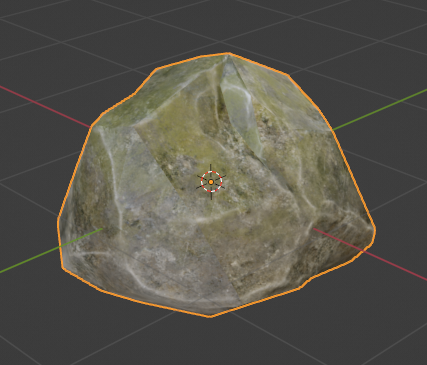
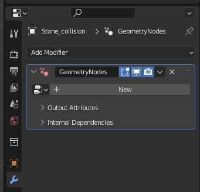
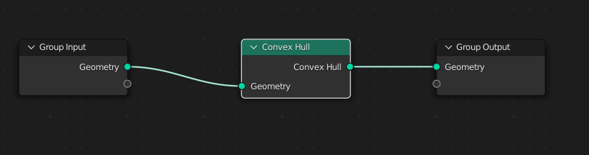
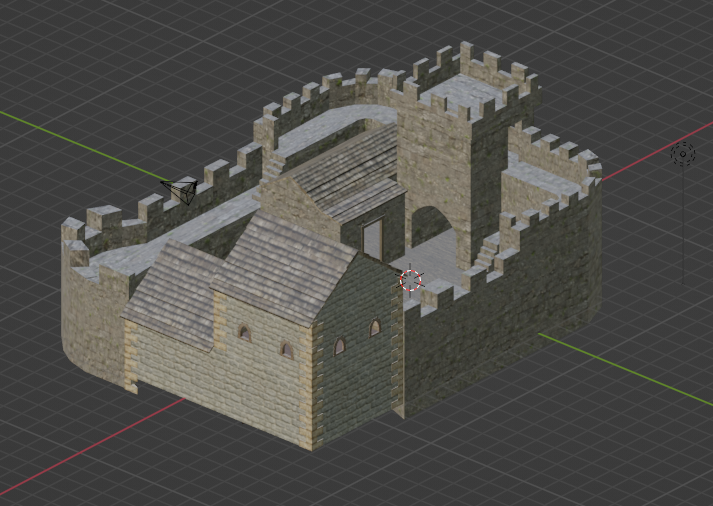
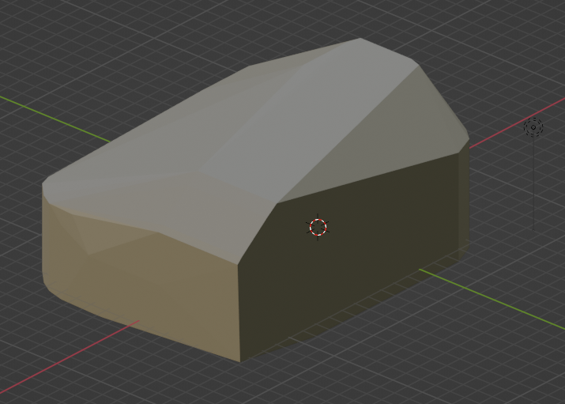
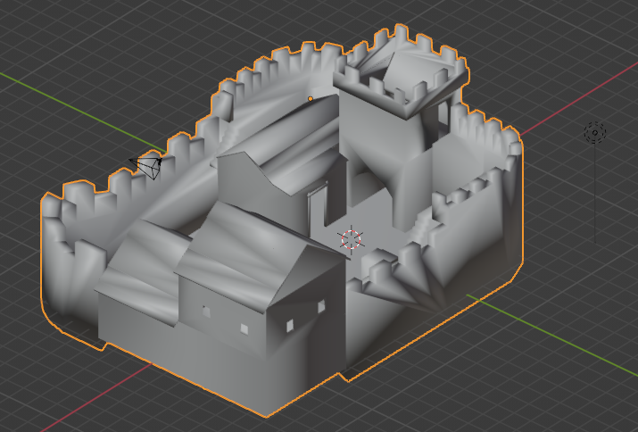

# Exporting for Physics Engines

## Index
 - [Introduction](#introduction)
 - [Exporting a Collision Mesh](#exporting-a-collision-mesh)
 - [Creating a Convex Hull](#creating-a-convex-hull)
 - [Using the Decimate Modifier](#using-the-decimate-modifier)
 - [Compound Shapes](#compound-shapes)
 - [Using the Collision Mesh in Ogre](#using-the-collision-mesh-in-ogre)
 - [Collision Geometry in the Visual Mesh](#collision-geometry-in-the-visual-mesh)

## Introduction
Since OGRE3D is a graphics engine, if you are interested in making a game then you are probably also using a physics engine.
Some of the most popular physics engines are:
 - [Havok Physics](https://www.havok.com/)
 - [NVIDIA PhysX SDK](https://github.com/NVIDIAGameWorks/PhysX)
 - [Bullet Physics](https://pybullet.org/wordpress/)

In the case of Bullet Physics, there is even an official OGRE Component that connects OGRE objects to the Bullet Physics world ([Bullet-Physics to Ogre connection](https://ogrecave.github.io/ogre/api/13/group___bullet.html#details)).

One common issue when using physics engines that relates to `blender2ogre` is the creation of collision meshes or hulls.

For the physics engine to operate at maximum efficiency the collision shapes in the world should be [Convex Hulls](https://en.wikipedia.org/wiki/Convex_hull).

So when creating a level in Blender and then exporting the mesh to render into OGRE3D, the same mesh or the same arrangement of vertices would in most cases be very inefficient to use as a collision mesh.

Primitive shapes:
 - Sphere Shape
 - Plane Shape
 - Box Shape
 - Cylinder Shape
 - Capsule Shape
 - Cone Shape

Complex shapes:
 - Compound Shape (Collection of primitive shapes)
 - Convex Hull Shape (A good analogy for a convex hull is an elastic membrane or balloon under pressure which is placed around a given set of vertices)
 - Triangle Mesh Shape (A triangle mesh shape is similar to the convex hull shape, except that it is not restricted to convex geometry)
 - Heightfield Shape (Used for terrain, because it can take elevation data from an image)
 - Soft Body Shape

Primitive shapes are not exported by `blender2ogre`; create them directly in OGRE (for example `Ogre::Bullet::createSphereCollider( const MovableObject * mo )` creates a Sphere Shape for the provided OGRE Movable Object).

Our concern is regarding more complex objects that require a more detailed collision shape that better fits the shape of the object.

An example could be some rocks that the player can climb on top of.
None of the primitive shapes approximate the random shape of a rock and if we tried the mismatch between the visual and the physical would be awkward for the player.

For this example, we are going to use the [Mossy Stone Rock](https://opengameart.org/content/mossy-stone-rock) from OpenGameArt.



## Exporting a Collision Mesh
For movable objects a triangle mesh is usually not allowed by the physics engine; a convex hull (or a compound of several convex hulls) is required instead.
The recommended workflow is to keep the visual mesh and the collision mesh separate and let `blender2ogre` link them:

1. Duplicate the visual object with `Shift-D`.
2. Rename the duplicate so that its name starts with `collision`, for example `collision.Rock`.
   This prefix is what marks the object as a collision proxy.
3. Parent the duplicate to the visual object (`Ctrl-P` -> `Object (Keep Transform)`).
   The proxy must keep the same transform as its parent; the proxy mesh is exported in the parent's local space.
   If you move the proxy after parenting, the export prints a warning and the collision mesh will not match the visual mesh.
4. Simplify the duplicate, either with a [Convex Hull](#creating-a-convex-hull) or with the [Decimate Modifier](#using-the-decimate-modifier).
5. Optionally hide the proxy. Hidden and unselected collision proxies are exported anyway.
6. Remove the materials from the proxy, since it will not be rendered.

The visual entity in the `.scene` file then gets a `collisionFile` attribute:

```xml
<entity name="Rock" meshFile="Rock.mesh" collisionFile="Rock_collision.mesh" />
```

The collision mesh is written next to the visual mesh and is named after the mesh data of the visual object, with a `_collision` suffix.
A few things to keep in mind:

 - There can only be one collision proxy per object because `collisionFile` is a single attribute. If several proxies are found, the first one is used and a warning is reported.
 - Objects that share the same mesh data share the same collision mesh.
 - Older files that mark the proxy with the `subcollision` property instead of the `collision` name prefix keep working:
   `bpy.context.object.subcollision = True`.

> **NOTE**: `collisionFile` is an extension of the DotScene format that is specific to `blender2ogre`.
> OGRE's official DotScene plugin does not read it, so your application has to read the attribute itself.
> See [Using the Collision Mesh in Ogre](#using-the-collision-mesh-in-ogre).

## Creating a Convex Hull
> **WARNING**: This section covers a feature only available since Blender version 3.0 (Geometry Nodes + Convex Hull)

In general for collision testing, it is most efficient to use the physics engines' primitive shapes, so if the asset can be put within one of these shapes it will consume fewer CPU resources (for example a barrel within a Cylinder Collision Shape).

Create the collision proxy as described in [Exporting a Collision Mesh](#exporting-a-collision-mesh): duplicate the object with `Shift-D`, name the duplicate `collision.Stone` and parent it to the visual object.
With the cloned object selected go to Modifiers and add the `Geometry Nodes Modifer`.



Create a new Geometry Node and then change the Layout to `Geometry Nodes` (layouts are in the top bar in Blender)

Now add a `Geometry Node` of type Convex Hull (Add (Shift-A) -> Geometry -> Convex Hull) and put the node between the `Group Input` and the `Group Output`



This will give you a simplified convex version of the mesh that can be exported by blender2ogre and then used as a collision shape in Jolt Physics, Bullet or even PhysX.

> NOTE: Very important!
Before exporting the mesh remember to set the shading to `Shade Smooth` (Object -> Shade Smooth), this is because `Flat Shading` makes `blender2ogre` export more vertices that would be necessary for this case.
Also, remember to remove the material since the collision mesh won't need it.

## Using the Decimate Modifier
But what if you want to use a model like this one:

[Stronghold](https://opengameart.org/content/stronghold) from OpenGameArt.

The object looks like this in Blender:



If we use a `Geometry Node` to create a Convex Hull, the result looks like this:



So, this cannot be used as a place where the player can go around going into the Stronghold and picking up loot.

In this case, a better approach is to duplicate the object as described in [Exporting a Collision Mesh](#exporting-a-collision-mesh), name the duplicate `collision.Stronghold`, parent it to the visual object and then add the `Decimate Modifier`.
Use the `Collapse` option and play with the `Ratio` lowering it as much as possible until the geometry starts collapsing too much.
Also:
 - Use the `Clean Up` menu (`Edit Mode`, Mesh -> Clean Up) to clean up the mesh to avoid as much degenerate geometry as possible.
 - Set the shading to `Shade Smooth` (Object -> Shade Smooth), this is because `Flat Shading` makes `blender2ogre` export more vertices that would be necessary for this case.
 - Remove the materials since the collision mesh won't need it.
 - This model has some ornaments that can be removed, like the window and door ledges which also reduces the complexity of the model.

The result is an object that looks bad but has a lower vertex count which will improve performance for the physics engine when calculating collisions.



Unlike a convex hull, a decimated mesh is a triangle mesh and is therefore only suitable for static geometry.
For movable objects, decompose the mesh into convex parts as described below.

## Compound Shapes
Many movable objects cannot be approximated well by a single convex hull, for example a chair or a hammer.
Physics engines handle this with a compound shape (`btCompoundShape` in Bullet, `JPH::StaticCompoundShapeSettings` in Jolt) that consists of several convex shapes.

To prepare this in Blender, model the collision proxy as a single mesh that contains one closed convex shell per part (duplicate the parts and join them with `Ctrl-J`).
At runtime, split the collision mesh into connected islands, create one convex hull per island and add them all to the compound shape, for example in Jolt:

```cpp
// islands: one point cloud per convex part, in the local space of the entity
JPH::StaticCompoundShapeSettings compound;
for (const JPH::Array<JPH::Vec3>& island : islands)
    compound.AddShape(JPH::Vec3::sZero(), JPH::Quat::sIdentity(),
                      new JPH::ConvexHullShapeSettings(island));
```

Alternatively, keep the parts in the visual mesh as separate `ogre.vertex.group.collision.*` submeshes, see [Collision Geometry in the Visual Mesh](#collision-geometry-in-the-visual-mesh).

## Using the Collision Mesh in Ogre
`collisionFile` is not part of the standard DotScene format; OGRE's DotScene plugin silently ignores it.
Your scene loader has to read the attribute and create the collider, for example while processing an `<entity>` element with [Jolt Physics](https://github.com/jrouwe/JoltPhysics):

```cpp
#include <OgreDefaultHardwareBufferManager.h>
#include <OgreMeshManager.h>
#include <OgreMeshSerializer.h>

// System-memory buffers for the collider meshes: no GPU resources are
// allocated and the meshes can be loaded without a render system.
// Keep this alive as long as any collision mesh is loaded.
static Ogre::DefaultHardwareBufferManagerBase defaultBufferManager;

Ogre::MeshPtr loadCollisionMesh(const Ogre::String& name)
{
    Ogre::MeshManager& meshManager = Ogre::MeshManager::getSingleton();
    if (Ogre::MeshPtr mesh = meshManager.getByName(name))
        return mesh;

    Ogre::MeshPtr mesh = meshManager.create(
        name, Ogre::ResourceGroupManager::DEFAULT_RESOURCE_GROUP_NAME);
    mesh->setHardwareBufferManager(&defaultBufferManager);

    Ogre::DataStreamPtr stream = Ogre::ResourceGroupManager::getSingleton().openResource(
        name, Ogre::ResourceGroupManager::DEFAULT_RESOURCE_GROUP_NAME);
    Ogre::MeshSerializer serializer;
    serializer.importMesh(stream, mesh.get());
    return mesh;
}

Ogre::Entity* entity = sceneManager->createEntity(name, meshFile);
// collisionFile was read from the <entity> element
if (!collisionFile.empty())
{
    Ogre::MeshPtr mesh = loadCollisionMesh(collisionFile);

    JPH::Array<JPH::Vec3> points;
    for (unsigned short i = 0; i < mesh->getNumSubMeshes(); ++i)
    {
        Ogre::SubMesh* sub = mesh->getSubMesh(i);
        // blender2ogre writes a shared vertex buffer by default; with the
        // Unshare Geometry option every submesh brings its own vertex data.
        Ogre::VertexData* data =
            sub->useSharedVertices ? mesh->sharedVertexData : sub->vertexData;
        const Ogre::VertexElement* pos =
            data->vertexDeclaration->findElementBySemantic(Ogre::VES_POSITION);
        Ogre::HardwareVertexBufferSharedPtr buffer =
            data->vertexBufferBinding->getBuffer(pos->getSource());

        points.reserve(points.size() + data->vertexCount);
        auto* base = static_cast<unsigned char*>(
            buffer->lock(Ogre::HardwareBuffer::HBL_READ_ONLY));
        for (size_t v = 0; v < data->vertexCount; ++v)
        {
            float* p;
            pos->baseVertexPointerToElement(base + v * buffer->getVertexSize(), &p);
            points.push_back(JPH::Vec3(p[0], p[1], p[2]));
        }
        buffer->unlock();
    }

    JPH::ShapeSettings::ShapeResult shape =
        JPH::ConvexHullShapeSettings(points).Create();
    if (shape.HasError())
    {
        // log shape.GetError(); the hull is degenerate, e.g. empty or coplanar
        return;
    }

    Ogre::SceneNode* node = entity->getParentSceneNode();
    JPH::BodyCreationSettings body(
        shape.Get(),
        JPH::RVec3(node->getPosition().x, node->getPosition().y, node->getPosition().z),
        JPH::Quat(node->getOrientation().x, node->getOrientation().y,
                  node->getOrientation().z, node->getOrientation().w),
        JPH::EMotionType::Dynamic, Layers::MOVING);
    bodyInterface.CreateAndAddBody(body, JPH::EActivation::Activate);
}
```

Notes:
 - The collision mesh is not attached to any entity; it is only loaded, so nothing is rendered.
 - `loadCollisionMesh` creates and imports the mesh manually because `MeshManager::load` does not allow choosing the buffer manager.
   `DefaultHardwareBufferManagerBase` (the non-singleton variant of `DefaultHardwareBufferManager`, declared in `OgreDefaultHardwareBufferManager.h`) keeps the vertex and index data in system memory, so loading colliders does not allocate GPU resources and works on a headless server.
   If the whole application runs without a render system, create the singleton `Ogre::DefaultHardwareBufferManager` before `Ogre::Root` instead.
 - Collision meshes use shared geometry by default. If the `Unshare Geometry` option is enabled, each submesh brings its own vertex data, which the loop above handles through `useSharedVertices`.
 - Mesh vertices are in the local space of the visual entity, so drive the body with the entity's `SceneNode` transform. If the node is scaled, scale the collision shape accordingly.
 - For static level geometry use a `JPH::MeshShapeSettings` built from the vertices and indexed triangles instead of a convex hull. Jolt only allows a `MeshShape` on static bodies.
 - If the collision mesh contains several islands (see [Compound Shapes](#compound-shapes)), group the vertices per island and create one `JPH::ConvexHullShapeSettings` per island.

## Collision Geometry in the Visual Mesh
Instead of a separate proxy you can store collision faces in the visual mesh as a submesh.
Assign them to a vertex group whose name starts with `ogre.vertex.group.`:

1. Select the faces that should be used for collision.
2. Create a vertex group named `ogre.vertex.group.collision` and assign the selected vertices with weight 1.
3. Export. The `.mesh` file gets an extra submesh named `collision` with the material `none`.

The vertices of the collision submesh are shared with the visual submeshes, so build the collision shape by walking the submesh's index data and only adding the vertices it references.
The example in [Exporting Custom Vertex Groups](README.md#exporting-custom-vertex-groups) shows how to read the index and vertex buffers of such a submesh.
Because the faces stay part of the rendered entity, define a `none` material that does not render anything, for example:

```
material none
{
    technique
    {
        pass
        {
            colour_write off
            depth_write off
            lighting off
        }
    }
}
```

To get several convex parts, use one group per part (`ogre.vertex.group.collision.1`, `ogre.vertex.group.collision.2`, ...).
Each group becomes its own submesh, which can be turned into a `JPH::ConvexHullShapeSettings` and combined in a `JPH::StaticCompoundShapeSettings`.

Limitations:
 - Every vertex of a face must belong to the group, otherwise the face is not exported to the submesh.
 - The collision submesh is only written for the default shared geometry; with the `Unshare Geometry` export option the vertex groups are ignored.
 - On meshes with an armature the vertices belong to the bone vertex groups, so this approach is not available.
   Use a separate collision proxy for skinned meshes.
 - The collision submesh is part of the rendered mesh; do not forget the `none` material.

See [Exporting Custom Vertex Groups](README.md#exporting-custom-vertex-groups) for more details about vertex group submeshes.
